# КТ-18 - Выполнение тестовых заданий

Студент - Денисенко Даниил Евгеньевич  
Группа - 4п4.23 NET  
Дисциплина - ADO.NET  

### Задания

Задачи:

1. Выполнить задание по ТЗ.
2. Дополнить функционал задания.
3. Оформить общий отчет со скриншотами и ссылками на код.

ТЗ:

Добавить страницу с динамическим графиком продаж, загружаемым из отложенной сборки.

Задачи:

1. Создать новую сборку SalesChartComponent.razor;
2. Добавить функции для отрисовки графиков;
3. Настройте отложенную загрузку;
4. Создать страницы с графиком продаж;
5. Добавить навигацию в NavMenu;
6. Запустить и проверить работу.

### Задание 1

Сделал график продаж в отдельной сборке SalesReportFeature
Она загружается при открытии графика, на главной странице её загрузка не нужна
Добавил ссылки в меню и два вида графика

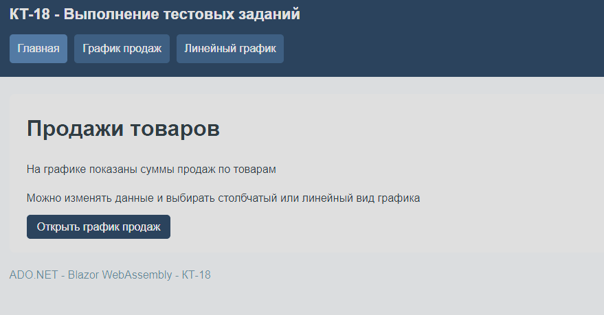

На главной странице есть описание и ссылка на график продаж

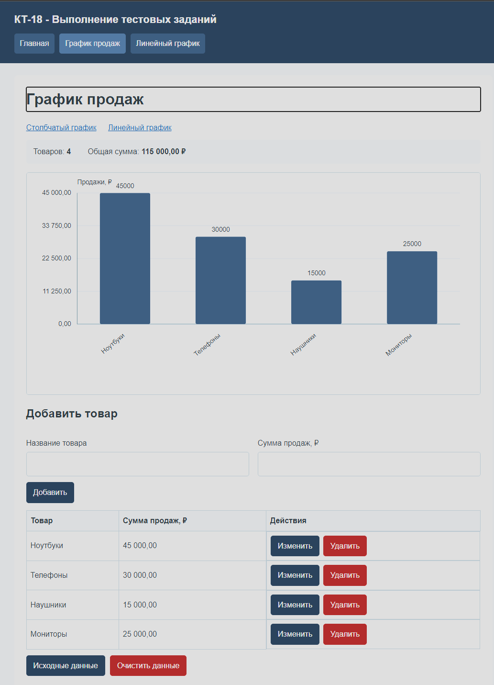

Столбцы показывают продажи четырёх товаров, ниже находятся форма и таблица

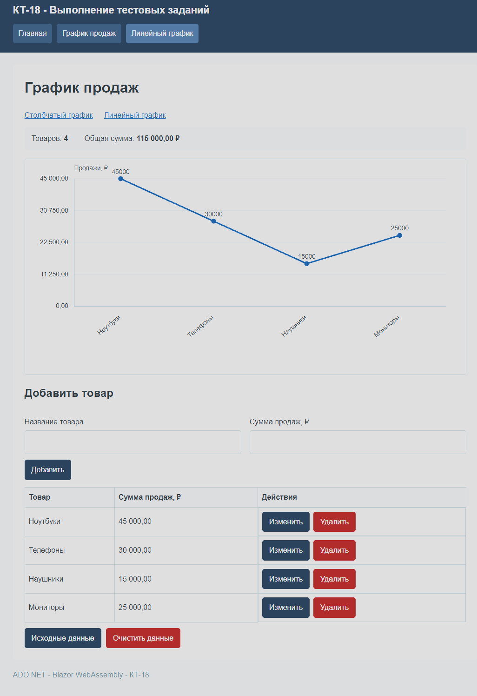

Те же данные отображаются в виде линии с точками

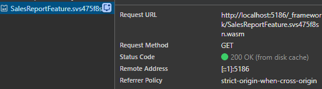

Запрос SalesReportFeature с расширением wasm появляется при переходе на страницу графика

### Задание 2

Добавил изменение списка товаров и сумм продаж
График и общая сумма обновляются после каждого изменения
Также сделал проверку ввода, очистку и возврат исходных данных

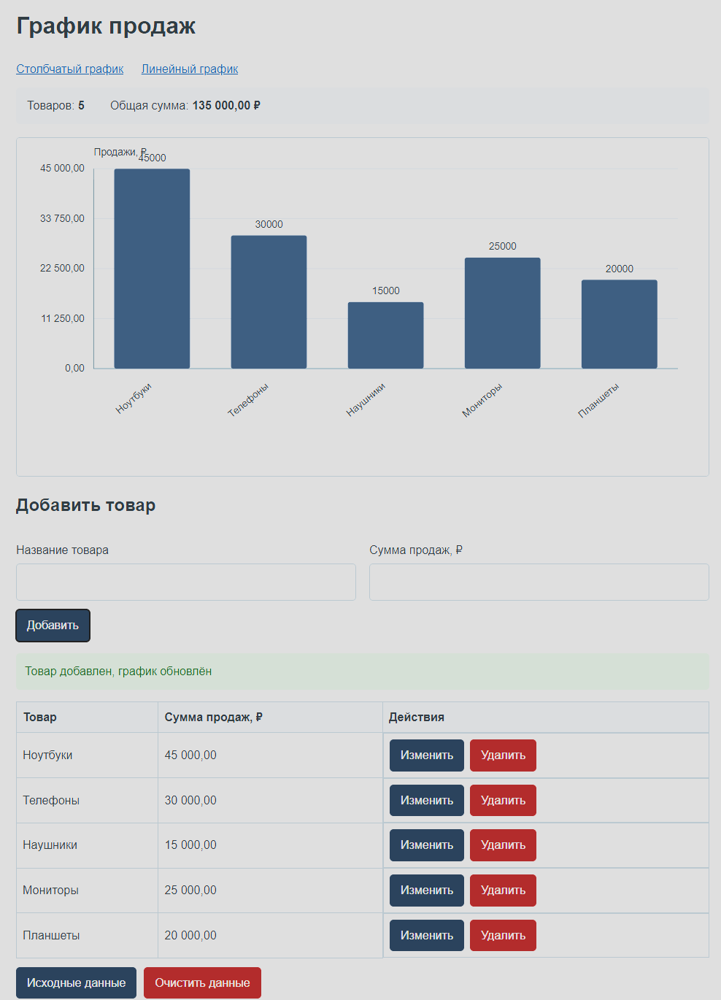

В список добавлены планшеты, на графике появился новый товар

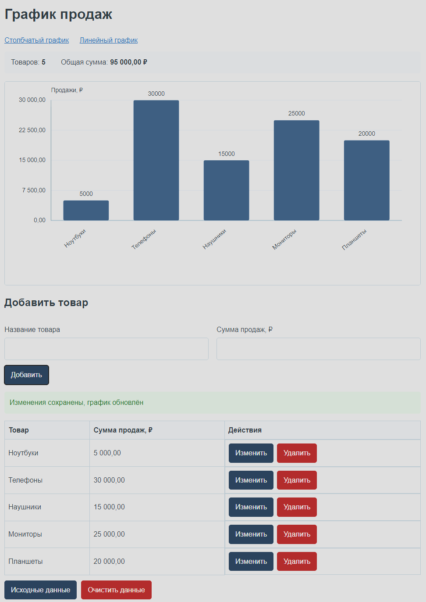

Сумма продаж ноутбуков изменена на 50 000 рублей, график пересчитан

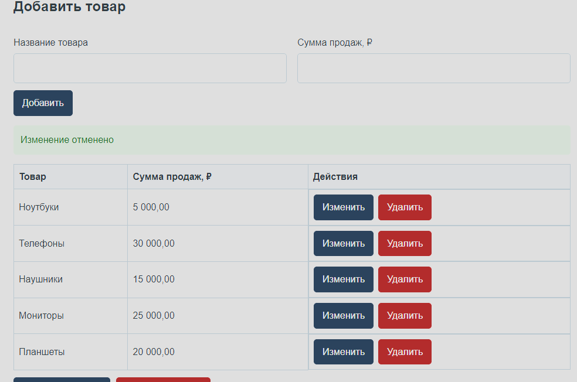

Изменение отменено, сохранённые данные остались прежними

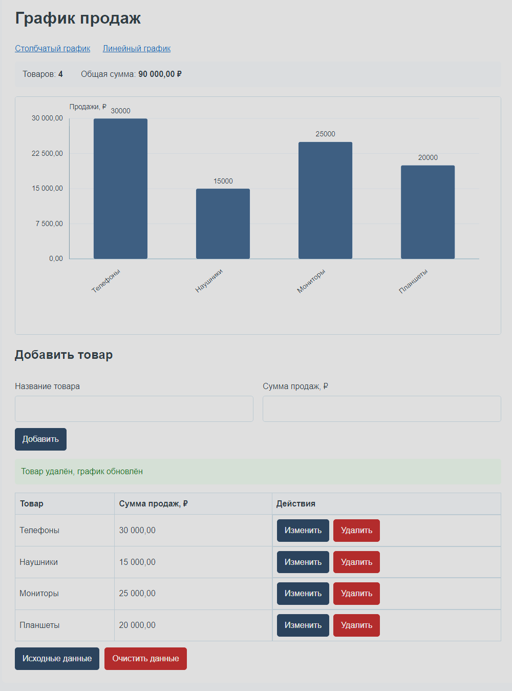

Ноутбуки удалены из таблицы и графика

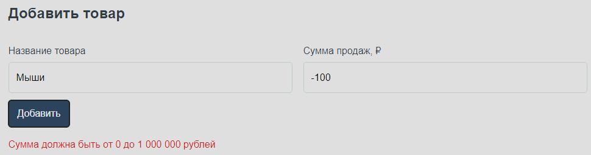

Отрицательная сумма не принимается, рядом с формой показана ошибка

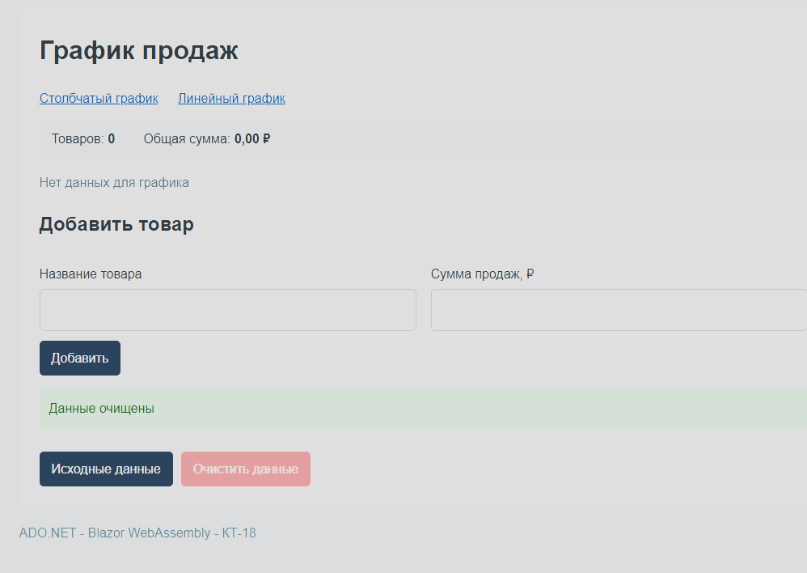

После очистки список пуст, вместо графика отображается сообщение

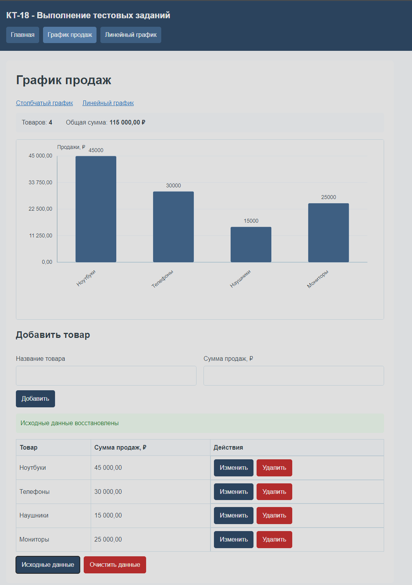

Восстановлены четыре исходных товара и их суммы продаж

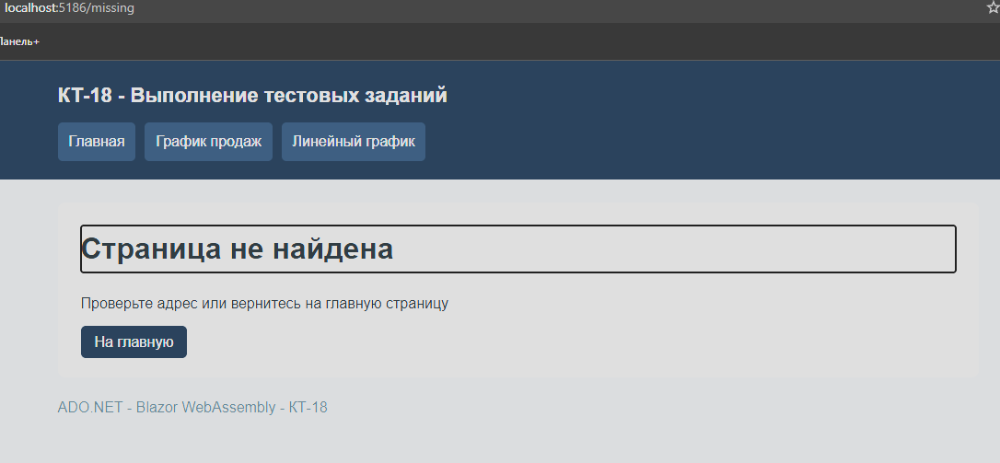

Для несуществующей страницы показано сообщение и ссылка на главную
